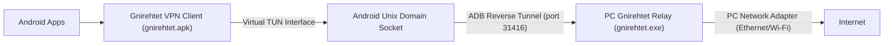

# Android USB Reverse Tethering Guide (Windows to Android)

Share your Windows PC's internet connection (Ethernet or Wi-Fi) with an Android mobile device over a USB cable without requiring root access.

---

## ⚡ Quick Start (One Command)

Open **PowerShell** on your Windows PC and run:

```powershell
irm https://raw.githubusercontent.com/Genymobile/gnirehtet/master/README.md > $null; Set-ExecutionPolicy Bypass -Scope Process -Force; [System.Net.ServicePointManager]::SecurityProtocol = [System.Net.SecurityProtocolType]::Tls12; & {
    $workDir = "$HOME\gnirehtet-tool"
    New-Item -ItemType Directory -Force -Path $workDir | Out-Null
    if (-not (Test-Path "$workDir\gnirehtet.exe")) {
        Write-Host "[1/3] Downloading Gnirehtet..." -ForegroundColor Cyan
        Invoke-WebRequest -Uri "https://github.com/Genymobile/gnirehtet/releases/download/v2.5.1/gnirehtet-rust-win64-v2.5.1.zip" -OutFile "$workDir\gnirehtet.zip"
        Expand-Archive "$workDir\gnirehtet.zip" -DestinationPath "$workDir\unpacked" -Force
        Copy-Item "$workDir\unpacked\gnirehtet-rust-win64\*" "$workDir\" -Force
        Remove-Item "$workDir\unpacked", "$workDir\gnirehtet.zip" -Recurse -Force
    }
    if (-not (Test-Path "$workDir\adb.exe")) {
        Write-Host "[2/3] Downloading Android Platform Tools (ADB)..." -ForegroundColor Cyan
        Invoke-WebRequest -Uri "https://dl.google.com/android/repository/platform-tools-latest-windows.zip" -OutFile "$workDir\tools.zip"
        Expand-Archive "$workDir\tools.zip" -DestinationPath "$workDir\unpacked" -Force
        Copy-Item "$workDir\unpacked\platform-tools\*" "$workDir\" -Force
        Remove-Item "$workDir\unpacked", "$workDir\tools.zip" -Recurse -Force
    }
    Write-Host "[3/3] Starting Reverse Tethering..." -ForegroundColor Green
    $env:PATH = "$workDir;" + $env:PATH
    & "$workDir\gnirehtet.exe" run
}
```

> **Note on Phone Screen**: The first time you run this, Android will ask for VPN permission:  
> *"Gnirehtet wants to set up a VPN connection..."* &rarr; Tap **OK**.

---

## 📋 Prerequisites

1. **Android Phone**:
   - Enable **Developer Options**: Go to *Settings > About Phone* and tap *Build Number* 7 times.
   - Enable **USB Debugging**: Go to *Settings > System > Developer options* and toggle on **USB debugging**.
   - Plug phone into PC via USB cable and select **"Always allow from this computer"** when prompted.
2. **Windows PC**:
   - Active internet connection (Ethernet or Wi-Fi).

---

## 🛠️ Step-by-Step Manual Setup

### 1. Download Tools
- **Android Platform Tools (ADB)**: [Download platform-tools](https://dl.google.com/android/repository/platform-tools-latest-windows.zip)
- **Gnirehtet (Rust Windows 64-bit)**: [Download gnirehtet release](https://github.com/Genymobile/gnirehtet/releases/latest)

Extract both into a single folder (e.g. `C:\Users\<You>\gnirehtet-tool`).

### 2. Verify ADB Detection
Open a command prompt in that folder:
```cmd
adb devices
```
Output should show:
```text
List of devices attached
<device_serial>    device
```

### 3. Start Reverse Tethering
In the same folder, run:
```cmd
gnirehtet.exe run
```

This single command will:
1. Automatically install `gnirehtet.apk` onto your connected Android device.
2. Request Android to start its local VPN service.
3. Configure the ADB reverse tunnel (`tcp:31416`).
4. Start relaying TCP and UDP network traffic from your PC's active network to the phone.

---

## 🔍 How It Works Under The Hood



1. **Android Side**: `gnirehtet.apk` creates a local Android `VpnService` that intercepts outgoing device network packets.
2. **Tunneling**: Packets are routed through ADB's native reverse socket bridge (`adb reverse localabstract:gnirehtet tcp:31416`).
3. **Host Relay**: The PC relay server parses TCP/UDP packets, forwards them to the PC's actual network adapter, and sends responses back over ADB.
4. **No Root Needed**: Standard Android VPN APIs are utilized, so rooting is not required.

---

## 🛑 How to Stop

- **From Command Line**: Press `Ctrl + C` in the terminal where `gnirehtet run` is running.
- **From Phone**: Pull down the notification shade, tap on the **Gnirehtet** or VPN notification, and tap **Disconnect**.
- **CLI Stop Command**:
  ```cmd
  gnirehtet.exe stop
  ```

---

## ❓ Troubleshooting

| Issue | Cause | Solution |
| :--- | :--- | :--- |
| `Device unauthorized` | Phone hasn't accepted PC key | Check phone screen, check "Always allow", tap OK. |
| `Ping doesn't work` | ICMP limitation | Gnirehtet relays TCP and UDP; ICMP (`ping`) is not supported. Test with browser or `curl https://google.com`. |
| `Relay tunnel disconnected` | Tunnel port closed or PC relay stopped | Re-run `gnirehtet tunnel` or restart `gnirehtet run`. |
| `Multiple devices connected` | ADB sees > 1 device | Specify serial: `gnirehtet run <SERIAL_NUMBER>`. |
